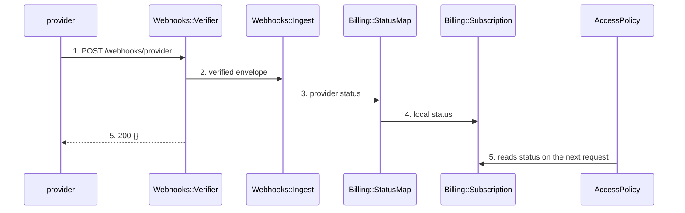
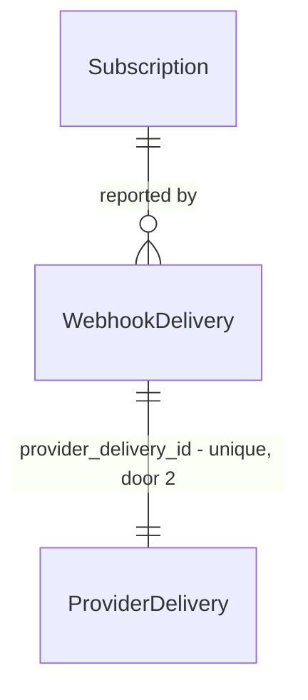

# Dunning on failed charge

**Approved**: 2026-10-23 - user: "approved, go ahead"
**Settled mid-build:** none
**Gates:** `npm test` @ `a1b2c3d` (exit 0, 214 passed, 0 failed, 0 skipped)
**Review:** sent at a1b2c3d
**Fix pass:** done - no changes needed
**Re-check:** not needed - Round 1 PASS

## Problem

A member whose card fails keeps full access until someone notices in the provider dashboard,
which took 11 days on the last three cases. Support absorbs the refund argument and the member
learns that paying is optional.

When this ships, a failed charge suspends access within one billing cycle and the member sees why.

## Shape

Reuses `Webhooks::Verifier` and the existing 90-day pruning job for delivery rows. All status
mapping, deduplication, and access checks run in `Billing::StatusMap`, `Webhooks::Ingest`, and
`AccessPolicy`, which unit and integration tests cover directly.

1. provider `POST /webhooks/provider` -> `Webhooks::Verifier` (exists) - verifies signature and envelope
2. `Webhooks::Ingest` (exists) - dedups on `provider_delivery_id`, persists `WebhookDelivery` (door 3)
3. `Billing::StatusMap` (new) - maps provider status to local status
4. `Billing::Subscription` (exists) - applies the transition, persists `status` (door 1)
5. out: `200` `{}`, and `AccessPolicy` (exists) reads `status` on the next request

**Changes underneath**

| Front | What changes | Consumers |
| --- | --- | --- |
| baseline | `a1b2c3d`: `npm test` exit 0 (214 passed, 0 failed, 0 skipped) | n/a |
| domain | `Active` meant "has a subscription row", now means "has a row and last charge succeeded" | `AccessPolicy#grant?`, `AdminSubscriptionsController#index`, `test/fixtures/subscriptions.json` |
| stored data | backfill existing rows to `active`; dedup 40k delivery rows before unique index | `AccessPolicy`, `AdminSubscriptionsController` |
| contracts | `subscriptions.status` enum adds `suspended` (expand-only) | `AccessPolicy#grant?`, `test/support/subscription-factory.ts` |

New: `WebhookDelivery` and its link to `Subscription`. One-way constraints: `provider_delivery_id`
unique (door 2), `status` not null with `suspended` in the enum (door 1).

## Surface

| Route | In | Out | Status | Who |
| --- | --- | --- | --- | --- |
| `POST /webhooks/provider` | provider envelope | `{}` · `{error}` | `200`, `401`, `409`, `422` | provider with valid signature; others get `401` |

## Landing

| One-way door | Literal shape | Alternative rejected | Reverse by |
| --- | --- | --- | --- |
| `subscriptions.status` gains `suspended` | enum value, not null, existing rows backfilled to `active` | boolean `is_suspended` - cannot express the next state | disable suspension handler flag and map `suspended` back to `active` in read path |
| delivery id uniqueness | unique index on `webhook_deliveries.provider_delivery_id` | dedup in application code - two workers race past it | drop unique index after draining webhook worker |
| new entity `WebhookDelivery` | one row per delivery, keyed on `provider_delivery_id` | column on `subscriptions` - one row per delivery, not per subscription | stop writes and drop `webhook_deliveries` table |
| `POST /webhooks/provider` response codes | `200` accepted/replayed, `409` concurrent duplicate, `422` missing subscription id | `204` - provider retries responses without a body | revert route handler before switching provider webhook endpoint |

- Nothing else in this change is hard to reverse

## Criteria

### S1: Suspension on a failed charge (P1)

A failed charge suspends the subscription and denies paid access.

**Acceptance Criteria**

1. WHEN the provider reports a failed charge THEN the system SHALL set the subscription status to `Suspended` (TLC-412-AC1)
   - first failed charge on `Active` → `Suspended`; second failed charge while `Suspended` → stays `Suspended`
2. IF the reported provider status is unknown THEN the system SHALL leave the status unchanged and record a `billing.status_unmapped` event
   - unknown status `"paused_v2"` → status unchanged, event recorded
3. WHILE a subscription is `Suspended` the system SHALL deny access to paid access groups
   - `Suspended` member requests `/pro/report` → `403`
4. The system SHALL never move a subscription directly from `Suspended` to `Trialing`
   - transition `Suspended → Trialing` → rejected

### S2: Webhook ingest (P1)

Replay of a delivery is a no-op; missing subscription id or invalid signature is rejected.

**Acceptance Criteria**

5. WHEN a webhook delivery id has already been processed THEN the system SHALL return `200` and change no records
   - duplicate `provider_delivery_id` → `200`, subscription row untouched
6. IF the provider payload is missing a subscription id THEN the system SHALL return `422` and persist nothing
   - payload without `subscription_id` → `422`, 0 new rows
7. IF a delivery carries no valid provider signature THEN the system SHALL return `401` and persist nothing
   - bad HMAC header → `401`, 0 new rows

## Out of scope

| Excluded | Why |
| --- | --- |
| Retry schedule configuration | the provider already owns retries |
| Dunning emails | copy is not written yet, tracked separately |

## Assumptions

| Assumption | Chosen default | Rationale | Confirmed? |
| --- | --- | --- | --- |
| Grace period after first failure | none - suspend on first failed charge | provider already retried 3 times before reporting failure | y |
| Status for a member never charged | stays `Active` | absence of a charge is not a failure | y |

**Open questions:** none - all resolved or logged above.

## Sources

- TLC-412 - suspension rule and 11-day evidence
- provider webhook reference - 9 statuses and 5 event types
