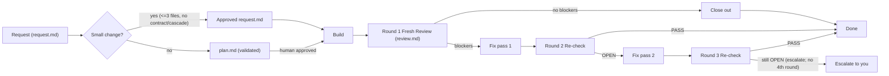

# Bundle design

The VS Code bundle in `vscode/.github/` is a workflow for teams that build features with coding agents. Teams select the skills they need, and `feature-workflow` is optional. This page explains why the bundle works the way it does and what it asks of you. For what each skill does, see the [README](../README.md#skill-scopes).

## At a glance

Coding agents fail in predictable ways. The bundle bounds each task, makes the agent's work checkable, and keeps consequential choices with you:

| Agent failure | The bundle's answer |
| --- | --- |
| Decides what is yours to decide | Product choices, scope, and tradeoffs go to you through the question tool, with a recommended option; answers update the spec and are not approval |
| Loses detail in a long context | A script sizes each dispatch and review, and subagents get a complete packet (`request.md`, `plan.md`, and diff) instead of the chat history |
| Calls work done too early | Every slice commits green, required gates record exit codes and counts on a clean tree, and UI changes are exercised in a browser |
| Invents commands, APIs, and facts | Agents never fabricate APIs, flags, or commands; assumptions never support PASS |
| Grades its own work generously | Every code change gets a fresh reviewer on another vendor's model with no author summary or hints, checking the verbatim request and diff |
| Weakens tests to go green | Every outcome-changing rule has a test that fails if the rule is wrong, tests change only with the claim they prove, and doubt triggers a scratch fault check |
| Forgets between sessions | Shared coding constraints live in `.specs/constraints/`, and feature state lives in the leading header of `plan.md` / `request.md` plus `git log` |

## How a behavior change moves

Three ideas shape this flow:

- **Small changes.** At most three files change, with no one-way door (no contract, schema, persisted field, dependency, migration, or cross-repository consumer change) and zero outside callers observing different behavior. A small change skips `plan.md`, records approval and EARS criteria in `request.md`, and still gets a fresh independent reviewer.
- **Plans.** A plan freezes what must be true before freeing how it is built: problem, numbered [EARS](https://alistairmavin.com/ears/) criteria, binding captures, vertical slices (S1 tracer bullet first), and consumer/compatibility impact. `validate_plan.py` checks structure before presentation.
- **Hard-to-reverse choices.** The plan's `Landing` section lists each one with the alternative it rejected. After approval, a changed decision records a `**Settled mid-build:**` entry (with user approval for product/contract shifts).

## Who does the work

`estimate_size.py` (or `delegation_gate.py` in the other harnesses) divides file bytes by four to estimate tokens. The build is sized on each slice's files, and the review on `request.md`, `plan.md` (when present), binding captures, and the diff / changed files:

| Estimated tokens | Build | Review |
| --- | --- | --- |
| Under 25k | Main session | One fresh reviewer on another vendor's model for every code change (pure non-logic edits skip review) |
| 25k to 150k | One subagent | One fresh reviewer on another vendor's model |
| Over 150k | Pieces of 150k or less, committed slice by slice | Split oversized features during planning so each accepted feature fits one end-to-end reviewer and one `review.md` |

A fixed threshold gives the same route on every run, where an agent's judgment drifts. The ceiling bounds what one agent is handed, because models use the middle of a long context less reliably ([Liu et al., 2023](https://arxiv.org/abs/2307.03172)). Both numbers are our settings, not measured limits. Markdown edits to docs, skills, and instructions get focused checks instead of an independent review.

The main session keeps scope, questions, `review.md`, and the final report. A subagent cannot ask you anything, so a builder that hits a missing decision or broken assumption stops and returns the question.

## What counts as done

| Rule | Why |
| --- | --- |
| Explicit user approval is recorded verbatim in `plan.md` (or small-change `request.md`) before building | Answering a question is not approving the plan |
| Agents never invent an API, a flag, or a command | A fabricated command becomes a green test that proves nothing |
| `**Gates:**` records each required command, its full repo SHA on a clean tree, exit code, and pass/fail/skip counts | A reviewer can verify the exact commit and reuse clean-tree gates without masking failures |
| Every code change gets a fresh reviewer on another vendor's model, with no author summary or hints | Models rate their own output higher ([Panickssery et al., 2024](https://arxiv.org/abs/2404.13076)) |
| When reading a test leaves doubt, the reviewer plants a temporary scratch fault on a clean tree and reverts it | Coverage shows which lines ran, not whether a bug is noticed ([Petrović et al., 2021](https://arxiv.org/abs/2103.07189)) |
| Every outcome-changing rule has a test that fails if the rule is wrong, and tests never weaken to clear a gate | Every kept test must prove a real claim |
| Scripts check plan shape, conventional commits, and constraint records; the reviewer checks substance | A script cannot tell whether an assertion or consumer impact is right |

The self-preference study measured preference, not defects caught, so the cross-vendor rule is our bet built on it.

## What the project remembers

Each kind of memory has its own audience and home:

| Memory | Read by | Lives in | Committed |
| --- | --- | --- | --- |
| Constraints | Coding agents | `.specs/constraints/`, one file per rule + `INDEX.md` | Yes, with the feature |
| Team decisions | People | `docs/roadmap/DECISIONS.md`, when the roadmap exists | Yes |
| Feature artifacts | The feature's sessions | `.specs/features/<feature>/` (`request.md`, `plan.md`, `captures/`, `review.md`) | No, git-ignored |

Two rules decide what gets written and what gets trusted:

- A constraint exists only when later features must follow it and the code cannot show it.
- On resume, the agent reconciles the leading state lines in `plan.md` / `request.md`, `review.md`, and `git log`. Commits record fact; notes record intent.

## What needs your approval

| Action | Needs |
| --- | --- |
| Local edits, and local commits of green slices that pass `check_commit.py` and `constraints.py check` | The approved plan (or approved small-change `request.md`) |
| Push, force-push, publication, deploy, production data, new dependencies, new branches, breaking contracts | Explicit approval for that action |
| Switching branches or revisions | Your request |
| Setup changes to the shared instructions | Your acceptance of the exact preview |

Personal preferences go in `.local/` only when you ask, and they cannot relax a check, a review, or a gate.

## How the bundle is written

These choices keep the instructions small and stable:

- **The always-on file stays small.** It holds the brief, routes, checks, and team rules in under 120 lines. Procedures live in skills that load on activation, following the [Agent Skills](https://agentskills.io/specification) model of progressive disclosure.
- **Setup owns only its marked parts.** Team text outside the markers survives each sync, and a conflicting edit inside them stops setup.
- **Instructions name the target behavior.** A hard prohibition comes paired with what to do instead. This is a house rule, not a measured effect.
- **Each rule has one owner.** Other files link to it.
- **Borrowing beats inventing.** `feature-workflow` adapts `tlc-spec-lean` 3.2.0 and `diagnosing-bugs` adapts Matt Pocock's skill. `ATTRIBUTION.md` files record the changes.

## What this asks of you

Your decisions unblock dependent work:

- Answer the questions, because an open product choice blocks the work that depends on it.
- Before approving a plan, read its `Landing` rows and `Changes underneath` table. They are the decisions and consumer impacts that are costly to undo.
- Keep models from two vendors available so every code change gets a qualifying cross-model reviewer.
- Fix blocking findings rather than overriding them; if blockers remain open after the 3rd review round (Round 3 re-check), decide the next step when the workflow escalates instead of starting a 4th review round.

## Porting to other harnesses

The bundle is the canonical source, and each harness port (`claude/project/`, `codex/project/`, `opencode/project/`) names only its own tools and paths. The [README](../README.md) explains the porting rules and lists every skill's scope.
