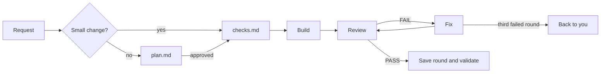

# Bundle design

The VS Code bundle in `vscode/.github/` is a workflow for teams that build features with coding agents. Teams select the skills they need, and `feature-workflow` is optional. This page explains why the bundle works the way it does and what it asks of you. For what each skill does, see the [README](../README.md#skill-scopes).

## At a glance

Coding agents fail in predictable ways. The bundle bounds each task, makes the agent's work checkable, and keeps consequential choices with you:

| Agent failure | The bundle's answer |
| --- | --- |
| Decides what is yours to decide | Product choices, scope, and tradeoffs go to you through the question tool, with a recommended option |
| Loses detail in a long context | A script sizes each dispatch and review, and subagents get a complete packet instead of the chat history |
| Calls work done too early | Every criterion is pass-or-fail in one run, and proof is a command with its exit code and test counts |
| Invents commands, APIs, and facts | Claims carry evidence tags, and an inferred claim cannot pass |
| Grades its own work generously | Above a size floor, a fresh reviewer on another vendor's model checks the work, and every review plants faults the tests must catch |
| Weakens tests to go green | No test is weakened to clear a gate, and a tautology checklist rejects tests that cannot fail |
| Forgets between sessions | Constraints, lessons, and handoffs live in separate files that outlive the session |

## How a behavior change moves

Three ideas shape this flow:

- **Small changes.** One behavior in at most three files, with no change to a contract, a schema, a persisted field, or a cross-repository consumer. A module interface other modules call counts as a contract. A small change skips `plan.md` but keeps its criteria and its review.
- **Plans.** A plan states the problem and the criteria before the solution's shape, so no component invents a criterion to justify itself. Each criterion is one [EARS](https://alistairmavin.com/ears/) sentence.
- **Hard-to-reverse choices.** The plan's `Landing` section lists each one with the alternative it rejected. After approval, a changed decision adds a superseding row with its reason.

## Who does the work

`estimate_size.py` divides file bytes by four to estimate tokens. The build is sized on each slice's files, and the review on the plan, checks, sources, and changed files:

| Estimated tokens | Build | Review |
| --- | --- | --- |
| Under 25k | Main session | Main session reviews itself and still plants faults |
| 25k to 150k | One subagent | One fresh reviewer on another vendor's model |
| Over 150k | Pieces of 150k or less. You choose sequential handoff or one builder with compaction | Pieces of 150k or less, one reviewer each |

A fixed number gives the same route on every run, where an agent's judgment drifts. The ceiling bounds what one agent is handed, because models use the middle of a long context less reliably ([Liu et al., 2023](https://arxiv.org/abs/2307.03172)). Both numbers are our settings, not measured limits. Markdown edits to docs, skills, and instructions get focused checks instead of a review.

The main session keeps scope, questions, review records, and the final report. A subagent cannot ask you anything, so a builder that finds a wrong check stops and returns the question.

## What counts as done

| Rule | Why |
| --- | --- |
| Claims are tagged `[CODE]`, `[INTERPRETED]`, `[INFERRED]`, or `[GAP]`, and `[INFERRED]` cannot support a PASS | A reviewer can audit each claim |
| Agents never invent an API, a flag, or a command | A fabricated command becomes a green test that proves nothing |
| Each proof records its command, exit code, and counts of tests run, failed, and skipped | A command can be rerun, and "tests pass" cannot |
| Each review round records the plan and checks hashes and the repository fingerprint | A later change makes the earlier proof stale |
| The independent reviewer runs on another vendor's model | Models rate their own output higher ([Panickssery et al., 2024](https://arxiv.org/abs/2404.13076)) |
| Inject 1 to 3 faults, up to 5 on critical paths, and every fault must be caught | Coverage shows which lines ran, not whether a bug is noticed ([Petrović et al., 2021](https://arxiv.org/abs/2103.07189)) |
| An extra test stays only if it catches a fault the others miss | Every kept test must be able to fail |
| Validators check formats, hashes, and counts, and the reviewer checks substance | A script cannot tell whether an assertion is right |

The self-preference study measured preference, not defects caught, so the cross-vendor rule is our bet built on it.

## What the project remembers

Each kind of memory has its own audience and home:

| Memory | Read by | Lives in | Committed |
| --- | --- | --- | --- |
| Constraints | Coding agents | `.specs/constraints/`, one file per rule | Yes, with the feature |
| Team decisions | People | `docs/roadmap/DECISIONS.md`, when the roadmap exists | Yes |
| Lessons | Coding agents | `.specs/lessons/` and `.specs/LESSONS.md` | Yes, in their own commit |
| Feature package and handoff | The feature's sessions | `.specs/features/<feature>/` by default | No, git-ignored |

Two rules decide what gets written and what gets trusted:

- A constraint exists only when later features must follow it and the code cannot show it.
- A lesson is confirmed only after the same mechanism fails in two different features. One failure is an anecdote.

On resume, the agent checks the notes against the checkout. A handoff records intent, and commits record fact.

## What needs your approval

| Action | Needs |
| --- | --- |
| Local edits, and local commits of green slices that pass the commit and constraint checks | The approved plan |
| Push, force-push, publication, deploy, production data, new dependencies, new branches | Approval for that action |
| Switching branches or revisions | Your request |
| Setup changes to the shared instructions | Your acceptance of the exact preview |

Personal preferences go in `.local/` only when you ask, and they cannot relax a check, a review, or a gate.

## How the bundle is written

These choices keep the instructions small and stable:

- **The always-on file stays small.** It holds the brief, routes, checks, and team rules in under 120 lines. Procedures live in skills that load on activation, following the [Agent Skills](https://agentskills.io/specification) model of progressive disclosure.
- **Setup owns only its marked parts.** Team text outside the markers survives each sync, and a conflicting edit inside them stops setup.
- **Instructions name the target behavior.** A hard prohibition comes paired with what to do instead. This is a house rule, not a measured effect.
- **Each rule has one owner.** Other files link to it.
- **Borrowing beats inventing.** `feature-workflow` adapts tlc-spec-lean and `diagnosing-bugs` adapts Matt Pocock's skill. `ATTRIBUTION.md` files record the changes.

## What this asks of you

Your decisions unblock dependent work:

- Answer the questions, because an open product choice blocks the work that depends on it.
- Before approving a plan, read its `Landing` rows. They are the decisions that are costly to undo.
- Keep models from two vendors available. From 25k up, a feature without a qualifying reviewer stays unverified.
- Fix a FAIL rather than overriding it. A surviving fault is a test gap.

## Porting to other harnesses

The bundle is the canonical source, and each harness port names only its own tools and paths. The ports add one thing the bundle runs by hand: with your approval, `feature-workflow` installs Git hooks that run the commit checks on every commit in a clone. The [README](../README.md) explains the porting rules and lists every skill's scope.
