# Plan

The one artifact a human reads to approve or challenge the work before code is written. Two halves in one review: **what must be true** and **what is being built**. Skip `plan.md` for small changes ([SKILL.md](../SKILL.md#small-changes)). For analysis without requested edits, stay read-only and report impact and open decisions.

## Before asking anything

1. **Save the request verbatim** under `## Request` in `.specs/features/<feature>/request.md`—every sentence as given, with attached capture paths listed. Keep workflow state lines above the first `## ` heading so user text never spoofs state. The reviewer reads `request.md` from disk after chat compacts.
2. **Read constraints and ground in code:** Run `python3 .opencode/skills/feature-workflow/scripts/constraints.py list` for expected areas and paths. Read accepted requirements/tickets, repository instructions, current code, callers, tests, and CI. Resolve findable facts in order: code/conventions → project docs → library docs → web (keep proprietary code, customer data, and internal URLs out of external tools).
3. **Open every binding source in full** (every capture, frame, and state) before writing the first criterion. If a binding source is unreachable, ask for the exported files as a `blocks` question.
4. **Check baseline:** Run baseline build, test, and lint commands individually (never masking a failure with `;`) once (except in a [greenfield first feature](#greenfield-first-feature)). A failing baseline stops work unless the user explicitly accepts the named failure.
5. **Size the feature early:** Keep the feature small enough for one end-to-end review; use `@orchestrate`'s advisory sizing helper when a change looks large (~150k estimated tokens). If it would grow too broad to review in one pass, propose a split into accepted sub-features that preserve cross-slice acceptance criteria so each accepted feature keeps one fresh reviewer and one `review.md`.
6. **Settle open architectural bets first:** If the architecture is genuinely undecided, settle it in an ADR, RFC, or spike and link it. `plan.md` records the shape that won.

## What must be true

### Problem without a solution
Write in the present tense with no solution inside it: what is true today that should not be, who pays for it, and what it costs. Copy literal source evidence or state that none was given. Close with one sentence stating what is different for a user when this ships.

### How to ask
A gray area is a product decision that has more than one defensible answer and is not settled by code or accepted requirements. Ask every gray area before presenting the plan—never hide a gray area as an `Assumptions` row to save a question.

- Lead with your recommendation and one line of why; ask at most two independent questions per turn (one when dependent).
- `"You decide"` is an answer: record it in `Assumptions` with `Confirmed? y` and rationale `user delegated`. Write `user delegated` only when the user actually said it.
- In `Assumptions`, `y` means a human confirmed it; use `n` for an unconfirmed safe default.
- New capabilities that surface during discovery go in `Out of scope` with a reason.
- Write each user answer into `plan.md` in the turn it arrives so compaction keeps it.
- Departing from a binding visual source (removing, renaming, or changing what it draws) is always the user's call: ask as a `blocks` question, record the approved departure in `## Differences from the source`, and cite either a `.specs/constraints/<slug>.md` record (if it binds future features) or `y - user: "<their words>"` (if feature-local).

### Walk the surfaces (mental sweep—no separate plan table)
Walk the applicable surface before writing criteria; each exposed decision becomes a criterion, named current behavior, or nothing to decide:
- **Screen / view:** empty, loading, error, unauthorized states; ordering; viewport widths (capture sizes, or asked when no capture exists); long-list/wide-table scroll behavior; destructive confirmation; what each control does when used.
- **API / event / webhook:** request & response shapes, error shapes & status codes, authN/authZ and denial codes, backward compatibility, rate limits, idempotency.
- **Command / scheduled job:** output format, flags & defaults, exit codes, partial-failure behavior.
- **Document / copy:** structure, tone, depth, reader next step.
- **Collection:** grouping, naming, ordering, duplicates, out-of-pattern exceptions.

### Criteria in EARS
Use EARS templates: `The <system> SHALL`, `WHEN <trigger> THEN the <system> SHALL`, `WHILE <state> the <system> SHALL`, `WHERE <feature> the <system> SHALL`, `IF <unwanted condition> THEN the <system> SHALL`. Preserve upstream requirement/ticket IDs beside criteria when present. A criterion you cannot imagine a test for is not ready.

- **Concrete & single-run settleable:** Pin exact status codes, fields, bounds, or payloads—never "quickly" or "properly". Split service targets (percentiles, uptime) into single-run behavior + observability.
- **Backend rules carry examples:** Under each rule criterion, add concrete input → output examples including a **strong case** (boundary or input where a naive implementation breaks).
- **Guarantees need a mechanism:** "A retry never creates a duplicate" points at the enforcing code or a `Landing` door.
- **Every UI control owes a gesture:** Name who acts, which control, and what the page shows afterwards.
- **Binding visual captures:** Any screenshot, design frame, or live site sent with the request **binds by default** (`non-binding` only when the user called it inspiration, quoted on `Sources` as `non-binding - user: "<their words>"`). A binding visual source is the measure of scope: build what it draws minus `## Differences from the source`. Save captures under `.specs/features/<feature>/captures/` with `.aria.yml` structural snapshots alongside `.png` where available, and embed each capture as a Markdown image in `Sources` (see template below). Each binding capture gets a numbered criterion naming the gesture and exact capture filename—do not retype the layout; add criteria only for control behavior, uncaptured states, and form rules. Copy labels character-for-character. Do not transcribe sample data into criteria, and ask the user whether the running app should hold that sample data at handover so captured states can be opened directly. Read the full request against captures so cut-off columns, below-the-fold rows, and uncaptured states are not missed.
- **Screens without a reference** state outcomes and target viewports, never layout.

## What is being built

Write `Problem`, walk surfaces, write `Criteria`, then fill `Shape`, `Surface`, and `Landing`. Leave reversible details (component catalogues, ordinary column types, internal helpers) to code.

### `## Shape` — path, drawings, data, and consumers
Open with two sentences: (1) what this reuses instead of duplicating, and (2) where outcome-changing rules (including filtering, searching, sorting, counting) run so tests reach them.

1. **Path:** Numbered hops from input to persistence/output. Mark existing modules `(exists)`—which stands only if that module already does what the criteria assign it—modules created by a door `(door <n>)`, or `(new)`.
2. **Drawing:** Mermaid `sequenceDiagram` (request/response) or `flowchart` (forks, fan-outs, async queues/jobs). Number arrows/nodes to match the path and use the **exact same module names** in both.
3. **Changes underneath (with `Consumers`):** Table of what already exists and changes (`baseline`, `domain`, `stored data`, `contracts`, `readers`), or `None - <reason>` when nothing existing changes.
   - **`Consumers` column (required whenever a table is present):** A contract is any shared type, service method, event, schema, or persisted field. Run reference search (**LSP + `rg`**) and list **production callers AND test fixtures, doubles, factories, and untyped files** (e.g., `.mjs` scripts, JSON fixtures) on every non-`baseline` row (or `none - <reason>`). Every named consumer gets a criterion, an `Out of scope` row, or an explicit verification mechanism (which must produce observed evidence during review).
   - **Multi-repo (zero overhead for single-repo):** When a change spans multiple repositories, keep one `plan.md` in the originating repo and add a **`Repo`** column to `Changes underneath` only when a row lives in another repo. Record each touched repo's base commit so review checks every touched repo's diff range. For a contract with consumers in another repo, order slices as **expand → migrate → contract** (add backward-compatible support first, migrate consumers, remove old path last), add a provable backward-compatibility criterion (`old shape still accepted`), and name each repo's slice commits/PRs in deploy order.
4. **Data:** Mermaid `erDiagram` (no attribute blocks—columns/types go stale) plus `New: <entities/relations or nothing - read only>` and one-way constraints. Use `Data: none - <why>` when nothing stored changes.
5. **States (when applicable):** Mermaid `stateDiagram-v2` with transitions and triggers.

### `## Surface`
Only new or changed externally consumed routes, tools, events, or public signatures: `Route | In | Out | Status | Who`. For HTTP routes, include exact status codes and denial status codes (`401`/`403`/`404`/`3xx`) whenever `Who` is not `anyone`. For non-HTTP interfaces (events, CLI commands, internal tools), state concrete outcome/error shapes and who may invoke them. Use `None - nothing consumed outside` when applicable.

### `## Landing`
Only hard-to-reverse choices (one-way doors): persisted schemas/constraints, consumer contracts, dependencies, backfills, new cross-cutting patterns. Columns: `One-way door | Literal shape | Alternative rejected | Reverse by`.
- `Reverse by` names the concrete back-out/recovery path (feature flag, expand-only revert, backfill reversal).
- Propose a `.specs/constraints/` record under `Landing` for any door future features must conform to (approved with the plan). By [constraints](constraints.md#roadmap-changes), stop for team agreement if a choice alters `docs/roadmap/DECISIONS.md`.
- Once approved, `Landing`, `Surface`, and stored shape rows are append-only: supersede with a new row instead of editing approved rows.

## Greenfield first feature

A project is greenfield while `AGENTS.md` `## Checks` has no command (and milestone 0 when `docs/roadmap/ROADMAP.md` exists).
- Run `git init` if needed; commit each green slice locally so review has a `HEAD` (using Git's empty-tree SHA `4b825dc642cb6eb9a060e54bf8d69288fbee4904` as the base when `HEAD` has no prior base commit).
- `Landing` records stack, persistence, and module layout with rejected alternatives and `Reverse by`, proposing `.specs/constraints/` records for each.
- Baseline reads `None - greenfield`.
- S1 builds a thin end-to-end walking skeleton with a build and test runner and at least one passing test.
- The last slice writes the new commands to `checks` in `docs/harness/setup-selection.json`, previews with `workflow-setup`'s `setup.py`, shows the team the preview, runs `--apply` after team approval, and commits those approved setup files before recording clean-tree `**Gates:**`.

## Template: `.specs/features/<feature>/plan.md`

`````markdown
# <Feature>

**Approved**: <written when user approves: YYYY-MM-DD - user: "their words">
**Settled mid-build:** none
**Gates:** <per-command results after final build commit: `cmd` @ `<full-or-short-sha>` (exit <N>, <P> passed, <F> failed, <S> skipped)>
**Review:** <written on dispatch: sent at <HEAD short hash> | skipped - non-logic edit>
**Fix pass:** <written after fix pass: done - <summary or no changes needed> | round 2 done - <summary>>
**Re-check:** <not needed - Round 1 PASS | sent at <HEAD short hash> | round 2 open | round 3 sent at <HEAD short hash> | PASS | open - escalated>

## Problem

<Present tense, no solution: what is true today, who pays, what it costs, and source evidence.>

<What is different for a user when this ships.>

## Shape

```mermaid
sequenceDiagram
    participant A as <Module>
    participant B as <Module>
    A->>B: 1. <input>
    B-->>A: 3. <response>
```

<One sentence on what this reuses. One sentence on where outcome-changing rules run so tests reach them.>

1. <input> -> `<Module>` (exists) - <what it does, what it hands on>
2. `<Module>` (exists) - <what it decides>, persists `<Entity>` (door 1)
3. out: `<response>`



**Changes underneath**

| Front | What changes | Consumers |
| --- | --- | --- |
| baseline | `<HEAD>`: `<cmd1>` exit 0 (<P> passed, 0 failed, <S> skipped); `<cmd2>` exit 0 | n/a |
| domain | `<Term>` changes from X to Y | `<caller>`, `<fixture>` |
| stored data | <backfill / migrate on read / none> | `<reader>` |
| contracts | `<Type/Event/Endpoint>` (expand-only / breaking) | `<caller>`, `<test fixture/double>` |

```mermaid
erDiagram
    <Entity> ||--o{ <Entity> : "<verb>"
```

New: <entities/relations or `nothing - read only`>. One-way constraints: <constraint> (door 1).

## Surface

| Route | In | Out | Status | Who |
| --- | --- | --- | --- | --- |
| `<METHOD> /<path>` | `<fields>` | `<fields>` | `200`, `401`, `422` | <caller>; others get `401` |

## Landing

| One-way door | Literal shape | Alternative rejected | Reverse by |
| --- | --- | --- | --- |
| <door> | <exact literal shape> | <alternative and why disqualified> | <revert / flag / recovery path> |

- Nothing else in this change is hard to reverse

## Criteria

### S1: <vertical slice — demonstrable user outcome> (P1)

<One-line outcome.>

**Acceptance Criteria**

1. WHEN <trigger> THEN the system SHALL <observable outcome with concrete value> (<upstream-ID>)
   - <normal input> → <result>; <strong boundary case> → <result>
2. IF <unwanted condition> THEN the system SHALL <response>
   - <invalid input> → <exact error/status>

## Out of scope

| Excluded | Why |
| --- | --- |
| <capability> | <reason> |

## Assumptions

| Assumption | Chosen default | Rationale | Confirmed? |
| --- | --- | --- | --- |
| <ambiguity> | <default> | <why> | y/n |

**Open questions:** none - all resolved or logged above.

## Differences from the source

<Include only when Sources marks a visual capture binding; otherwise omit.>

| Source shows | Product shows | Confirmed |
| --- | --- | --- |
| <label/control/state> | <product behavior or nothing> | y - <constraint-slug or user: "their words"> |

<Or:> None - the product matches the source

## Sources

- <ticket or spec> - <what it settles>
-  - binding - <what it draws>
- <inspiration reference> - non-binding - user: "<their words>" - <what it informs>
`````

## Validate and confirm

1. Re-read `request.md` sentence by sentence: every sentence must land on a criterion, an `Out of scope` row, or an open question.
2. Run `python3 .opencode/skills/feature-workflow/scripts/validate_plan.py <feature>` and fix every error.
3. Present `Shape`, `Consumers`, `Landing` doors (with `Reverse by`), assumptions, and any blockers—then **stop**. Answers to questions update the plan and are **not** approval; re-present the updated plan. After explicit user approval, write `**Approved**: <YYYY-MM-DD> - user: "<their words>"` in `plan.md`. Unless the user explicitly asked to continue in the current thread (e.g., "approved, build here"), **stop** and output a short copyable prompt in a plaintext code block for starting implementation in a fresh thread (do not create a handoff file or launch a thread automatically):

   ```text
   Implement the approved plan in .specs/features/<feature>/plan.md using @feature-workflow.
   ```

   Otherwise continue to [build](build.md).
